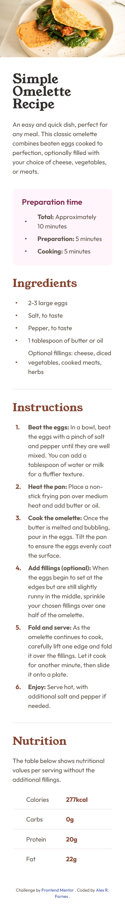
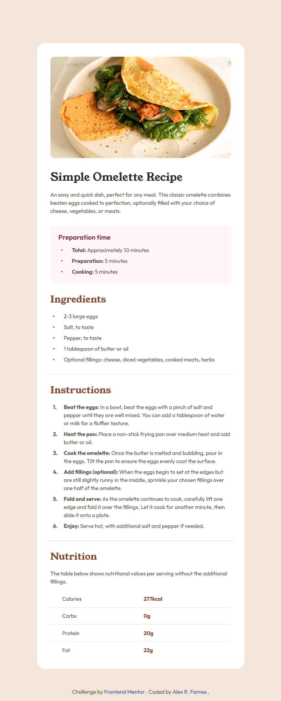
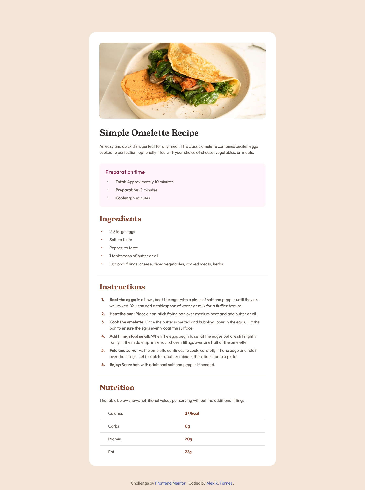

# Frontend Mentor - Recipe page solution

This is a solution to the [Recipe page challenge on Frontend Mentor](https://www.frontendmentor.io/challenges/recipe-page-KiTsR8QQKm). Frontend Mentor challenges help you improve your coding skills by building realistic projects.

## Table of contents

- [Frontend Mentor - Recipe page solution](#frontend-mentor---recipe-page-solution)
  - [Table of contents](#table-of-contents)
  - [Overview](#overview)
    - [Screenshot](#screenshot)
      - [Mobile](#mobile)
      - [Tablet](#tablet)
      - [Desktop](#desktop)
    - [Links](#links)
  - [My process](#my-process)
    - [Built with](#built-with)
    - [What I learned](#what-i-learned)
    - [Continued development](#continued-development)
    - [Useful resources](#useful-resources)
    - [AI Collaboration](#ai-collaboration)
  - [Author](#author)

## Overview

### Screenshot

#### Mobile



#### Tablet



#### Desktop



### Links

- Solution URL: [https://github.com/AlexRFarnes/recipe-site](https://github.com/AlexRFarnes/recipe-site)
- Live Site URL: [https://alexrfarnes.github.io/recipe-site/](https://alexrfarnes.github.io/recipe-site/)

## My process

### Built with

- Semantic HTML5 markup
- CSS custom properties
- Flexbox
- CSS Grid
- Mobile-first workflow
- `@font-face` for self-hosted fonts
- CSS counters

### What I learned

I learned how to replace the browser's default list marker when I need more control over how it looks.

For the unordered lists, a `::before` pseudo-element acts as the bullet. It is a real box, so I can set its size, color, and the space between the dot and the text.

For the ordered list, CSS counters create the numbers. `counter-reset` starts the count on the list, `counter-increment` advances it on each item, and `counter()` prints the current number in `::before`.

```css
.instructions__list {
  counter-reset: step;
}

.instructions__item {
  counter-increment: step;
}

.instructions__item::before {
  content: counter(step) ".";
}
```

### Continued development

I want to get better at page layout, and at organizing CSS so it stays maintainable on larger projects.

### Useful resources

- [Using CSS counters](https://developer.mozilla.org/en-US/docs/Web/CSS/Guides/Counter_styles/Using_counters) - This explains `counter-reset`, `counter-increment`, and `counter()`, which is how the instruction numbers are generated.
- [::before](https://developer.mozilla.org/en-US/docs/Web/CSS/Reference/Selectors/::before) - This explains the pseudo-element I used for the custom bullets.
- [CSS lists and counters](https://developer.mozilla.org/en-US/docs/Web/CSS/Guides/Lists) - This is the overview of list markers and counters, useful when I come back to custom lists later.

### AI Collaboration

I used Cursor to talk through problems while I built the page. The assistant asked questions and gave hints instead of writing the solution. Explaining the problem out loud made it easier to decide what to try next. Getting finished code would have skipped that thinking.

## Author

- Website - [Alex R. Farnes](https://www.alexrfarnes.dev/) (🚧 site in construction)
- Frontend Mentor - [@AlexRFarnes](https://www.frontendmentor.io/profile/AlexRFarnes)
- LinkedIn - [@alexrfarnes](https://www.linkedin.com/in/alexrfarnes)
